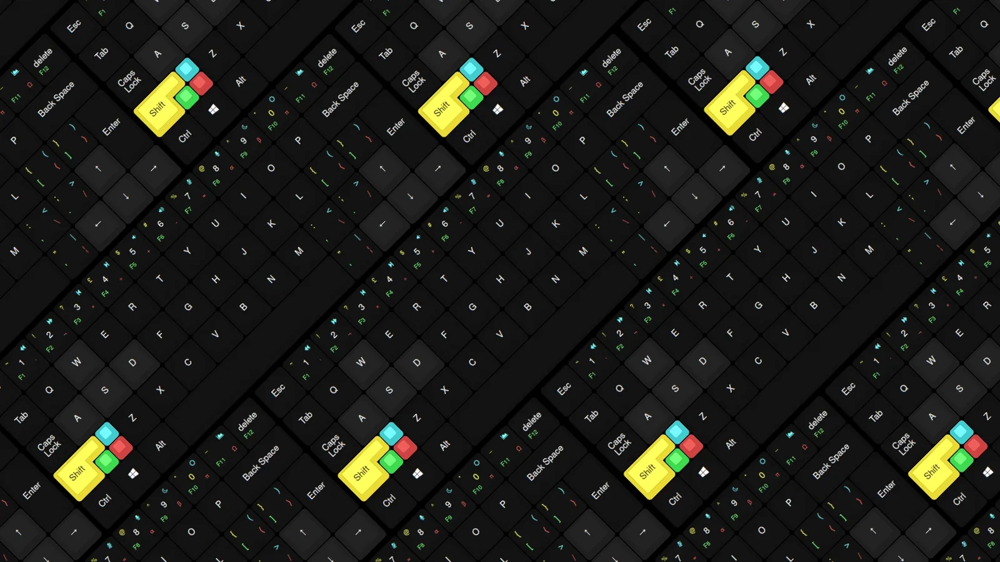
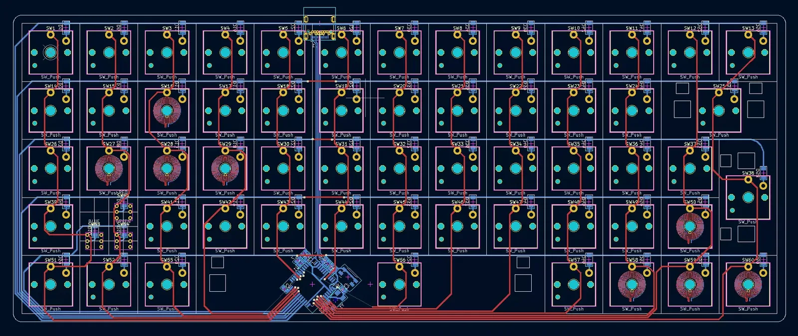
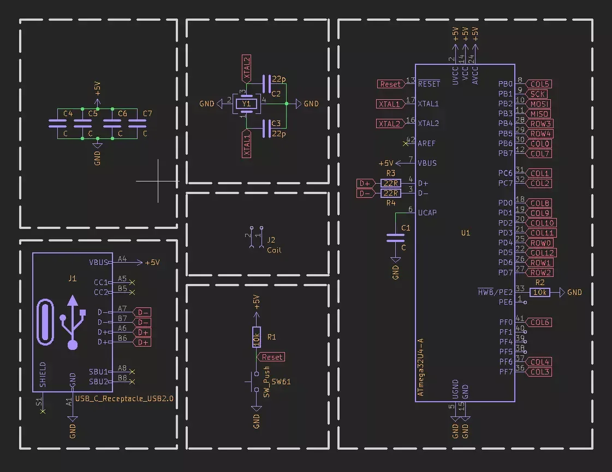
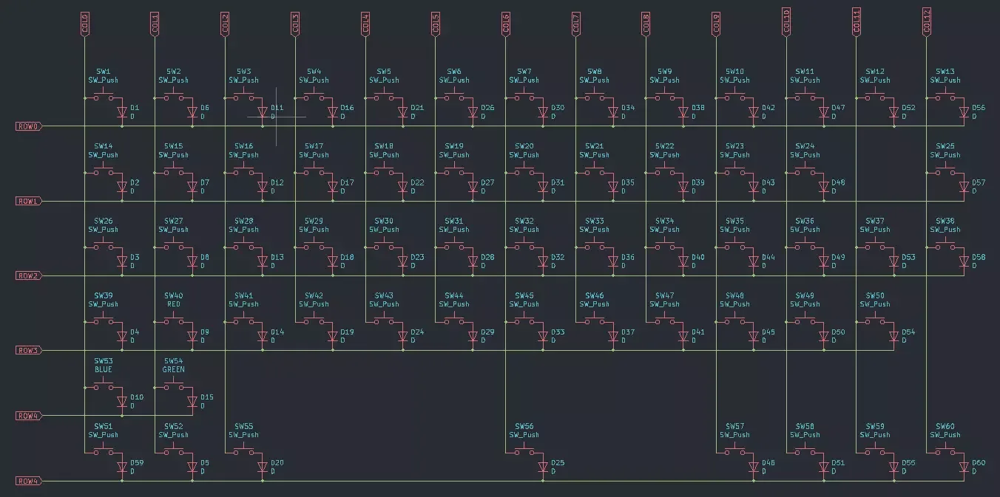
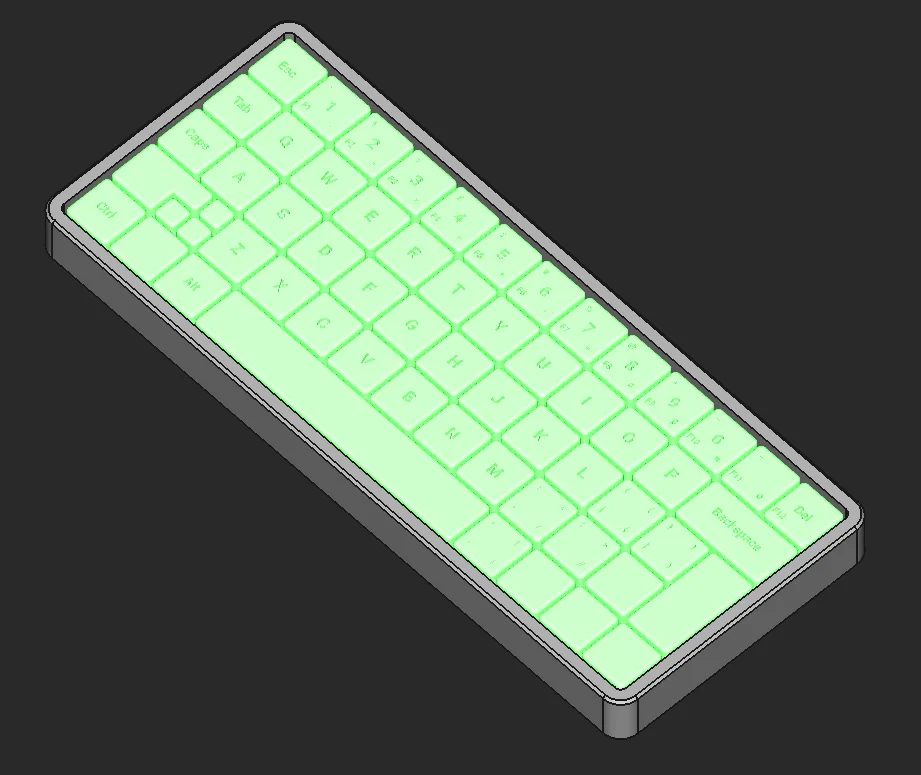
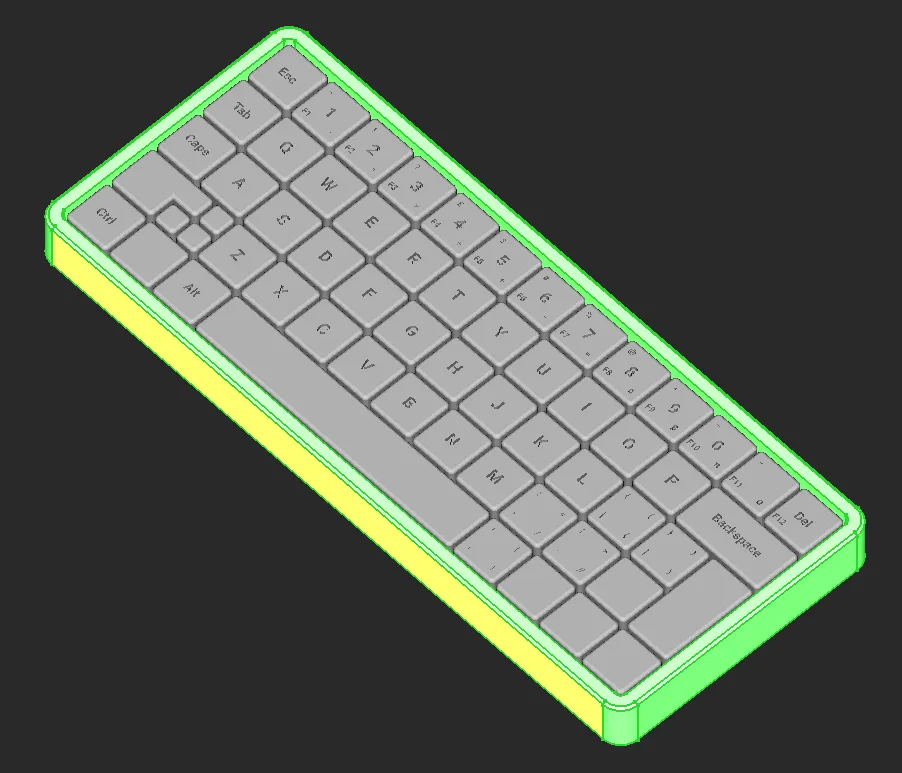

# ORTHODOX

A custom ortholinear mechanical keyboard comprising a 60-key, two-layer PCB designed in KiCad, a FreeCAD case and parametric OpenSCAD keycaps. The design uses Kailh Choc switches, per-key diodes and USB-C, with copper coil footprints reserved for future analogue sensing.



## Overview

Orthodox is a design archive for a compact ortholinear keyboard. Its grid layout removes the row offsets of a conventional staggered keyboard, simplifying both the keycap geometry and the electrical matrix. The repository contains the KiCad schematic and PCB, manufacturing exports, a FreeCAD case model and a parametric keycap generator.

This repository covers the hardware and mechanical design. Firmware is not included, the LDC1614 inductive-sensing circuit is planned but not present on this PCB revision, and no fabrication, assembly or measurement results are recorded. The files are useful as a reference design or starting point for further work, not as a verified build guide.

## Features

- **60-key ortholinear matrix:** thirteen columns and five rows, including 2u keys, a 6u spacebar and smaller 0.5u keycaps.
- **Per-key diodes:** sixty 1206 surface-mount diodes, one for each switch position.
- **ATmega32U4 controller:** a TQFP-44 ATmega32U4-A with a four-pad crystal, reset circuit and decoupling.
- **USB-C connection:** a GCT USB4055-30-A receptacle wired for USB 2.0 data and power.
- **Kailh Choc footprints:** 1u, 2u and 6u switch positions using Kailh Choc V1 footprints, plus compact 58-series footprints for the smallest keys.
- **Coil-enabled key positions:** eight switch footprints on W, A, S, D and the four arrow keys include dual-layer copper spirals for future inductive sensing.
- **Two-layer PCB:** 1.6 mm FR4, approximately 253.15 x 100.75 mm, with 467 routed track segments and 23 vias.
- **Manufacturing exports:** Gerber, drill and job files in `Hardware/PCB/export/`, plus a STEP model of the board.
- **FreeCAD case model:** a Part Design body measuring approximately 259.26 x 107 x 20 mm.
- **Parametric keycaps:** a KeyV2-based OpenSCAD generator with per-key positions, sizes, heights and five legend layers.
- **Coil generator:** a Python script that emits KiCad track segments for the spiral coils.

## Technologies

- **KiCad:** schematic capture, PCB layout, design rules, 3D preview and Gerber generation.
- **FreeCAD:** parametric case modelling with sketches, pads, pockets and chamfers.
- **OpenSCAD and KeyV2:** parametric keycap geometry, legends and STL export.
- **Python 3:** generation of the Archimedean spiral tracks used by the coil footprints.
- **ATmega32U4:** the USB-capable AVR microcontroller at the centre of the board.
- **Kailh Choc V1 and 58-series switches:** switch footprints used by the PCB.
- **USB-C:** the board's power and data connector.
- **LDC1614 (planned):** the intended inductive-sensing device for the coil-equipped keys, not yet implemented on the PCB.

## Gallery



The PCB layout shows the 13-column matrix, eight spiral coil footprints, the ATmega32U4 and the USB-C connector.



The schematic covers the USB-C interface, crystal, reset circuit, decoupling and the ATmega32U4 pin assignments.



The matrix uses thirteen column nets and five row nets, with one diode per switch.



The keycap layout includes mixed key sizes, smaller 0.5u keys and multiple legend positions.



The FreeCAD case model provides the outer enclosure around the PCB and keycap assembly.

## Technical details

### PCB and matrix

The board uses thirteen column nets, `COL0` to `COL12`, and five row nets, `ROW0` to `ROW4`, with one 1206 diode in series with each switch. Sixty switch positions are placed in the layout. The controller is an ATmega32U4-A in a TQFP-44 package. USB-C is wired for USB 2.0, with 22R series resistors on the data lines, a crystal with 22 pF load capacitors, a reset switch and a 10 kΩ pull-up on the reset line.

The board is a two-layer, 1.6 mm FR4 design measuring approximately 253.15 x 100.75 mm. The routed board contains 467 track segments and 23 vias. An online view of the board is available on [CADLAB.io](https://cadlab.io/project/25013).

### Inductive coil footprints

Eight switch positions, covering W, A, S, D and the four arrow keys, use special footprints containing a copper spiral around the switch centre. The spiral is drawn on both copper layers and uses 0.15 mm tracks with 0.30 mm spacing over eight turns. Each footprint adds two small SMD pads, numbered 3 and 4, for the coil terminals.

`Software/spiral.py` generates the spiral as individual KiCad `segment` entries and prints them to standard output. The radius, number of sides, track width, track spacing, turn count and layer can be changed at the bottom of the script. The design stops at the coil footprint: the schematic includes a two-pin `Coil` connector (`J2`), but no LDC1614 or other inductive-sensing IC is placed on the board.

### Case

`Hardware/Model/Keyboard/Keyboard.FCStd` contains a FreeCAD Part Design body with a sketch, pad, pocket and chamfer. Its outer envelope is approximately 259.26 x 107 x 20 mm. The repository does not include separate fabrication drawings or fit measurements for the case.

### Keycaps

`Hardware/Model/Keycaps/OrthodoxLayout.scad` is built on [KeyV2](https://github.com/rsheldiii/openSCAD-projects). It defines the position, width, height and legend of every key using explicit arrays, including the 2u keys, 6u spacebar and 0.5u keys. Five nested `legend()` calls place primary, function-key, symbol and shift legends at different positions on each keycap.

The layout uses the low-profile transformation, bar supports, an 18.16 mm base width and a nominal 11.5 mm total depth before the low-profile transformation. The included `OrthodoxLayout.stl` is a pre-exported model spanning approximately 247 x 94 x 8 mm. The layout file contains a commented `$stem_type = "choc"` setting; uncomment it before export to generate stems for the Choc switches.

## Challenges and solutions

### Integrating coils into switch footprints

- **Problem:** The analogue keys need a planar coil under each switch, but the switch cutout, central hole and electrical pads occupy the middle of the footprint.
- **Approach:** `spiral.py` generates the coil as many short KiCad track segments. These are embedded directly in a modified Kailh Choc footprint, using a larger pad arrangement and a spiral that surrounds the switch centre on both copper layers.
- **Outcome:** Eight coil-enabled footprints exist in the PCB layout. The sensing IC and its supporting circuit remain unbuilt, so the coil geometry has not been electrically validated.

### Placing multiple legends on small keycaps

- **Problem:** KeyV2's `legend()` module is designed around a single legend per keycap, while the Orthodox layout needs several legends on many keys.
- **Approach:** The layout nests five `legend()` calls with separate arrays for the centre, bottom-left, bottom-right, top-left and top-right positions. Font sizes and offsets are defined per key, including the smaller 0.5u keys.
- **Outcome:** A single OpenSCAD file produces the full 60-key layout and an STL export. The commit history records an attempt to add Font Awesome glyphs and notes that multiple-font rendering still needed investigation.

### Mixing key sizes in a regular grid

- **Problem:** An ortholinear grid is regular, but the design mixes 1u, 2u, 6u and 0.5u keys, so a single uniform array cannot describe the layout.
- **Approach:** The keycap generator stores explicit x/y positions, widths and heights for every key, with separate arrays for legends and font sizes. The PCB uses matching switch footprints and positions for the 2u, 6u and compact keys.
- **Outcome:** The layout and STL include the mixed key sizes. No physical fit test is recorded in the repository.

## Validation status

No fabricated board, assembly photographs, bill of materials or electrical measurements are included. A design rule check (DRC) run using KiCad 10.0.7 on `Hardware/PCB/Orthodox.kicad_pcb` reports 10 unconnected items and additional clearance, footprint, solder-mask and other violations, so the design should be reviewed and cleaned up before manufacture. The case and keycap models have not been physically validated for fit in this repository.

## Getting started

### Prerequisites

- KiCad 6 or newer for the schematic and PCB (the files use the KiCad 6 format).
- FreeCAD for the case model.
- OpenSCAD for the keycap generator.
- Python 3 for the coil generator.
- A PCB fabricator if manufacturing the board.

### Opening the design

```bash
git clone https://github.com/BenjaminJAnderson/Orthodox.git
cd Orthodox
```

Open `Hardware/PCB/Orthodox.kicad_pro` in KiCad to inspect the schematic and PCB. Open `Hardware/Model/Keyboard/Keyboard.FCStd` in FreeCAD for the case, and `Hardware/Model/Keycaps/OrthodoxLayout.scad` in OpenSCAD for the keycaps.

### Generating a coil

```bash
python3 Software/spiral.py
```

The script prints KiCad `segment` entries to standard output. Adjust the parameters at the bottom of the script, then paste the output into the PCB or a footprint as required.

### Exporting keycaps

```bash
openscad Hardware/Model/Keycaps/OrthodoxLayout.scad -o OrthodoxLayout.stl
```

The repository also includes a pre-exported `Hardware/Model/Keycaps/OrthodoxLayout.stl`.

### Manufacturing files

Gerber and drill files are in `Hardware/PCB/export/`. The STEP model of the board is `Hardware/PCB/Orthodox.step`. No firmware or flashing instructions are provided.

## Roadmap

- [ ] Integrate the LDC1614 sensing circuit and connect the eight coil footprints.

## Project structure

```text
Orthodox/
├── Hardware/
│   ├── PCB/
│   │   ├── Orthodox.kicad_pro / .kicad_sch / .kicad_pcb
│   │   ├── export/            # Gerbers, drill files and job file
│   │   ├── footprints/        # Kailh Choc and USB footprints
│   │   ├── resources/         # Datasheets and vendor references
│   │   └── references/        # Third-party keyboard designs
│   └── Model/
│       ├── Keyboard/          # FreeCAD case model
│       └── Keycaps/           # KeyV2 generator and Orthodox layout
├── Software/
│   └── spiral.py              # Coil track generator
├── docs/images/               # README images
└── README.md
```

## Credits and licensing

No licence file is currently included with this repository. The original design files remain the copyright of the author; contact the author through the repository for reuse permission.

Third-party components retain their own licences:

- **KeyV2** by rsheldiii is licensed under GPL-3.0; the keycap generator in `Hardware/Model/Keycaps/` is derived from it.
- **scad-utils** by Oskar Linde is licensed under the MIT licence; see `Hardware/Model/Keycaps/src/libraries/scad-utils/LICENSE`.
- **Round Anything** (`polyround.scad`) is licensed under the MIT licence.
- **Kailh Choc V1 footprints** are licensed under CC-BY-SA 4.0 with the exception stated in `Hardware/PCB/footprints/Kailh-Choc-V1/LICENSE`.
- **Reference designs** in `Hardware/PCB/references/` are third-party projects and retain their own licences; consult the licence and README files supplied with each project where present.
- **Datasheets** in `Hardware/PCB/resources/` remain the copyright of their respective manufacturers.
